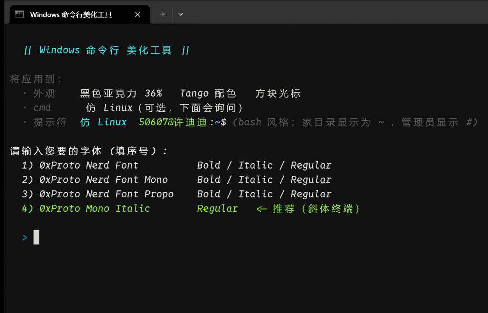
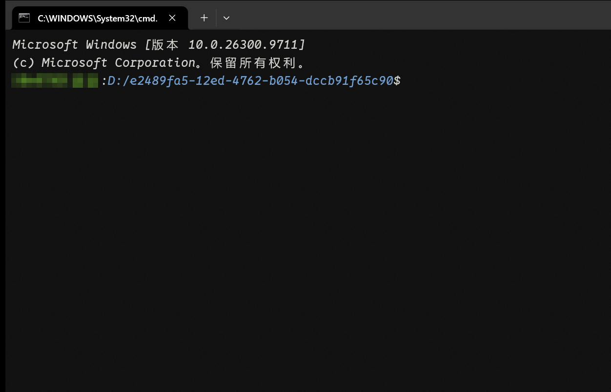
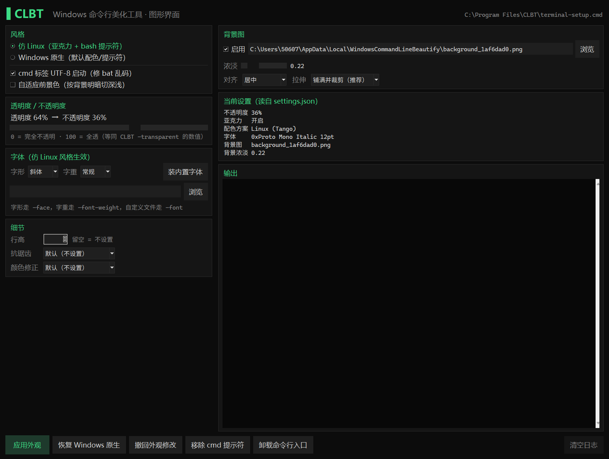

# CLBT —— Windows 命令行美化工具

> 一条命令，把 Windows Terminal 变成仿 Linux 的黑玻璃终端；再一条命令，还原成 Windows 原生。

- **单文件分发**：`install.exe`（25 MB）自带 10 个 Nerd Font 字体，双击即装
- **标准安装位置**：默认装进 `C:\Program Files\CLBT`，`--dir` 可改到任意目录
- **两种风格**：仿 Linux（黑色亚克力 + bash 提示符）/ Windows 原生
- **背景图 + 透明度**：图片按"水印"强度自动跟随窗口透明度，互不打架
- **自适应前景色**：窗口透明时，按周围背景明暗自动切换深/浅色文字
- **自动解决 bat 乱码**：安装时把 Terminal 里的 cmd 标签改成 UTF-8 启动
- **图形界面（可选）**：`clbt_gui.py`，tkinter 零依赖，勾选式改外观，和命令行完全等价






## 快速开始

### 方式一：用现成的安装器（推荐）

1. 从 [Releases](../../releases) 下载 `CLBT.zip`（唯一附件，安装器就在里面）
2. 解压，双击 `CLBT\install.exe` —— 它会装到 `C:\Program Files\CLBT`，途中弹一次 UAC 授权
   想装到别处（不需要管理员）：`install.exe --dir D:\Tools\CLBT`
3. 重新打开终端，输入 `CLBT -help`

安装器会做这几件事：

| 动作 | 说明 |
|---|---|
| 释放工具本体 | 写出 `C:\Program Files\CLBT\terminal-setup.cmd`（33 MB，内含字体） |
| 生成入口命令 | 写出 `C:\Program Files\CLBT\CLBT.cmd` |
| 装上图形界面 | 写出 `C:\Program Files\CLBT\CLBT-GUI.exe`（11 MB，双击即可用） |
| 加入用户 PATH | 只写 `HKCU`，不影响系统 PATH，重复运行不产生重复项 |
| 开启 UTF-8 | 把 Terminal 里 cmd 标签的 commandline 改成 `cmd.exe /k chcp 65001 >nul` |

不想自动改编码：`install.exe --no-encoding`

### 方式二：从源码构建

```bat
python build_package.py          :: 模板 + 字体 -> terminal-setup.cmd
python make_dist.py              :: 生成 dist\CLBT.zip
python -m PyInstaller --onefile --console --name install ^
  --distpath dist --workpath build --specpath build --noconfirm ^
  --icon dist\icon.ico --version-file version_info.txt ^
  --add-data "terminal-setup.cmd;." install.py
```

## 命令一览

```bat
CLBT                                   交互式菜单（7 步问答）
CLBT -linux                            仿 Linux：黑色亚克力 + Tango 配色 + bash 提示符
CLBT -win                              Windows 原生：Campbell 配色 + 不透明 + 默认提示符

CLBT -transparent 40                   透明度（0=不透明，100=全透）
CLBT -opacity 60                       不透明度（与 Terminal 的 opacity 同义）

CLBT -background "D:\pics\bg.png"      背景图（png/jpg/jpeg/gif/bmp，也可给目录）
CLBT -background off                   移除背景图
CLBT -bg-opacity 0.55                  背景图浓淡（默认 0.55；越小越透）
CLBT -bg-align topLeft                 对齐：center/top/bottom/left/right/topLeft/...
CLBT -bg-stretch uniform               拉伸：uniformToFill/fill/uniform/none

CLBT -font "D:\fonts\my.ttf"           安装并使用指定字体（文件或目录）
CLBT -face "0xProto Nerd Font Mono"     直接用已安装的字族（不用传文件路径）
CLBT -font-weight bold                 字重：常规 normal / 粗体 bold
CLBT -acrylic off                      关掉亚克力磨砂（这样才是真透明，能看到桌面）
CLBT -install-fonts                    只安装内置的 10 个字体，不改任何设置
CLBT -cell-height 1.2                  行高 0.8–2.0
CLBT -antialiasing grayscale           抗锯齿：grayscale/cleartype/aliased
CLBT -adjust-colors always             不可辨颜色修正：always/indexed/never

CLBT -adaptive                         开启自适应前景色
CLBT -adaptive off                     关闭
CLBT -encoding on|off                  让 cmd 标签以 UTF-8 启动（消除 bat 乱码）

CLBT -gui                              打开图形界面（等价双击 CLBT-GUI.exe）
CLBT -diagnose                         环境诊断：设置写到了哪、当前窗口由谁渲染
CLBT -uninstall                        撤回对命令行的全部修改
CLBT -help                             显示帮助
```

**不指定 `-linux` / `-win` 时会沿用当前风格**——只调透明度不会把风格改掉。

## 交互菜单

```
  || Windows 命令行 美化工具 ||

请选择操作 (填序号) :
  1) 应用美化   选择风格 / 透明度 / 字体，并可选 cmd 提示符与自适应前景色
  2) 撤回修改   还原外观、提示符、cmd 挂钩、自适应（等价于 -uninstall）
  3) 查看帮助   列出全部命令行用法（等价于 -help）
```

选 1 后依次询问：风格 → 透明度 → 字体（含"自定义字体文件"）→ cmd 提示符 → 背景图 → 高级外观（行高/抗锯齿/颜色修正/背景对齐/背景浓淡）→ 自适应。每步直接回车都用推荐默认值。

## 图形界面（可选）

不想敲参数就开图形界面：

**已经装好的人**直接双击 `C:\Program Files\CLBT\CLBT-GUI.exe`，或者在终端里：

```bat
CLBT -gui
```

**从源码跑**：

```bat
python clbt_gui.py
```



- 只用 Python 自带的 tkinter，不装任何第三方库；Windows 官方 Python 自带 tkinter
- 打开时**读当前 settings.json 预填界面**，不会一上来就把既有设置覆盖成默认
- 勾什么就调什么，背后仍然是同一个 `terminal-setup.cmd`，所以界面和命令行结果完全一致，
  日志区会原样打印实际执行的命令和输出
- 能做的事：风格（仿 Linux / 原生）、透明度、背景图（浓淡 / 对齐 / 拉伸）、字体（字形
  **斜体 / 等宽 / 标准 / 比例** + 字重 **常规 / 粗体**，或直接指定字体文件）、行高、抗锯齿、
  颜色修正、UTF-8 编码、自适应前景色，以及「恢复 Windows 原生 / 撤回外观修改 /
  移除 cmd 提示符 / 卸载命令行入口」
- `python clbt_gui.py --selftest` 只打印将要执行的命令，不开窗口
- 打包 exe 时用 `--manifest gui.manifest`（per-monitor DPI 感知），125% / 150% 缩放下不发虚

## 它会修改什么（透明披露）

| 位置 | 内容 | 可撤销 |
|---|---|---|
| `%LOCALAPPDATA%\Packages\Microsoft.WindowsTerminal_*\LocalState\settings.json` | 配色、透明度、背景图、字体、光标等 | `CLBT -uninstall`（自动备份 `.bak-*`） |
| `%USERPROFILE%\Documents\WindowsPowerShell\Microsoft.PowerShell_profile.ps1` | 仿 Linux 提示符 + 键位 | 同上（删除本工具生成的 profile） |
| `%LOCALAPPDATA%\Microsoft\Windows\Fonts` + `HKCU\...\Fonts` | 按当前用户安装字体 | 手动删除 |
| `HKCU\Environment\Path` | 加入 `C:\Program Files\CLBT` | `install.exe --uninstall` |
| `C:\Program Files\CLBT\` | 安装目录（`terminal-setup.cmd` + `CLBT.cmd`） | `install.exe --uninstall` |
| `HKCU\Software\Microsoft\Command Processor\AutoRun` | **仅在交互里选 y 时**写入，用于 cmd 提示符 | `CLBT -adaptive off` / `CLBT -uninstall` |
| Terminal 中 cmd 配置的 `commandline` | 追加 `/k chcp 65001 >nul` | `CLBT -encoding off` |

默认目录在 `C:\Program Files` 下，所以安装时要过一次 UAC；除此之外只写文件 + `HKCU`，不修改系统级设置（不动 `HKLM`）。想全程免提权就用 `--dir` 指到当前用户可写的位置。

## 卸载

```bat
CLBT -uninstall          :: 撤回外观/提示符/cmd 挂钩/自适应，字体与工具本体保留
install.exe --uninstall  :: 彻底卸载命令本身（清 PATH + 删 C:\Program Files\CLBT 里的文件）
```

## 常见问题

**运行时会冒出 `'5)' 不是内部或外部命令`、`'--apply' 不是内部或外部命令`？**
v1.0.2 已修复。旧版本文档区里有中文注释，在 `chcp 65001` 的控制台里 cmd 会算错行偏移、
把注释片段当命令执行。升级到 v1.0.2 即可，不需要改任何设置。

**它会改我的 PowerShell 执行策略吗？**
不会。执行策略是 Restricted/AllSigned 时，工具只提示你自己要跑的命令
（Set-ExecutionPolicy -Scope CurrentUser -ExecutionPolicy RemoteSigned），不会替你改。

**它会不会覆盖我自己配的字体 / 内边距？**
第一次改动前会把你原有的 ont / padding / scrollbarState 存一份快照
（%LOCALAPPDATA%\WindowsCommandLineBeautify\defaults-snapshot.json），CLBT -uninstall 时还原。

**运行 .bat 中文乱码？**
不是字体问题，是**代码页**。cmd 默认 936(GBK)，UTF-8 编码的 bat 就会乱。安装器已经自动把 cmd 标签改成 UTF-8 启动；反之 GBK 编码的老 bat 会乱，用记事本另存为 UTF-8 即可。

**设置了背景图但 PowerShell 标签看不到？**
多半是单个配置文件里写了 `backgroundImage: null` 覆盖了全局默认。工具现在会自动清除这类覆盖。

**调了透明度却看不出变化？先跑 `CLBT -diagnose`**
它会把这几件事打出来：设置文件的实际路径与当前 `opacity` / `useAcrylic`、你当前这个窗口的
进程链（是不是 `WindowsTerminal.exe`）、已装的 Terminal 版本、系统「透明效果」开关。
最常见的原因是**在 VS Code 的集成终端里看效果**——那里不读 Windows Terminal 的
`settings.json`，改什么都白改。

**调了透明度却看不出变化？**
两种可能：①**亚克力磨砂**开着——它给窗口加了一层磨砂材质，透明度只影响磨砂层的浓淡，
看起来就像"没反应"。想要真透明：图形界面里取消勾选「亚克力磨砂」，或命令行 `CLBT -acrylic off`。
②桌面/壁纸本身很暗，透出来还是黑的——换张亮一点的壁纸再试。
改完记得点「应用外观」，并新开一个终端标签页。

**背景图让透明感消失？**
图片和窗口透明度是两个独立图层，叠加后 ≈ `窗口 + 图片×(1-窗口)`。用 `-bg-opacity` 调低图片浓淡即可。

**我换了图，终端没刷新？**
图片按内容哈希命名，换图会换文件名。若缓存未刷新，重启终端一次。

**杀软报毒？**
未签名 PyInstaller 产物常见误报。可以自行 `python install.py` 运行源码，或按 [README_SIGN.md](README_SIGN.md) 签名。

**exe 没签名？**
是。签名路线见 [README_SIGN.md](README_SIGN.md)（个人最现实的是 Certum OSS 或 SignPath）。

## 版本号规则

版本号是 `MAJOR.MIDDLE.MINOR`，按 **15 进制** 进位：

- 每 **15 个小版本** 进 1 个中版本：`1.0.15 → 1.1.1`
- 每 **15 个中版本** 进 1 个大版本：`1.15.15 → 2.0.1`
- 进位后低位从 1 开始重新计数（`0` 只出现在最初的 `1.0.0`）

唯一版本源是仓库里的 `version.json`，发版时用脚本同步，别手改散落的版本文件：

```bat
python bump_version.py                 :: 看当前版本 / 下一个版本（预演，不写文件）
python bump_version.py --next --write  :: 进位并同步 version.json、两个 version_info、clbt_gui.py
python bump_version.py --set 1.1.3 --write
python bump_version.py --check         :: 校验各处版本是否与 version.json 一致（发版前必跑）
python bump_version.py --selftest      :: 进位规则回归用例（1.0.15→1.1.1、1.15.15→2.0.1 等）
```

## 仓库结构

```
├─ terminal-setup.src.cmd      模板：批处理头 + PowerShell 正文（不含字体数据）
├─ adaptive-watch.ps1          自适应前景色守护（base64 内嵌进成品）
├─ install.py                  安装器源码
├─ clbt_gui.py                 图形界面（tkinter，可选）
├─ build_package.py            打包：模板 + 字体 -> terminal-setup.cmd
├─ make_dist.py                生成 dist\CLBT.zip
├─ make_icon.py                生成图标（多尺寸 ICO）
├─ make_italic_family.py       把斜体样式改造成独立字体家族
├─ refresh_adaptive.py         修改守护脚本后刷新内嵌 base64
├─ sign.cmd / version_info.txt 签名与版本信息
├─ *.ttf                       0xProto Nerd Font（SIL OFL 1.1，见 LICENSE）
├─ italic-family\              改造出的斜体独立家族
└─ screenshots\                文档截图
```

⚠️ 成品 `terminal-setup.cmd` 是**构建产物**（33 MB，含 base64 字体），已加入 `.gitignore`，请用 `build_package.py` 生成。

## 许可

- **工具本体（脚本/代码）**：MIT
- **字体**：SIL Open Font License 1.1，Copyright (c) 2023, 0xType Project Authors，详见 [LICENSE](LICENSE) 与 [NOTICE.md](NOTICE.md)

> 本项目修改过字体（把 Mono Italic 重命名为独立家族 `0xProto Mono Italic`），衍生字体同样以 OFL 1.1 发布。
